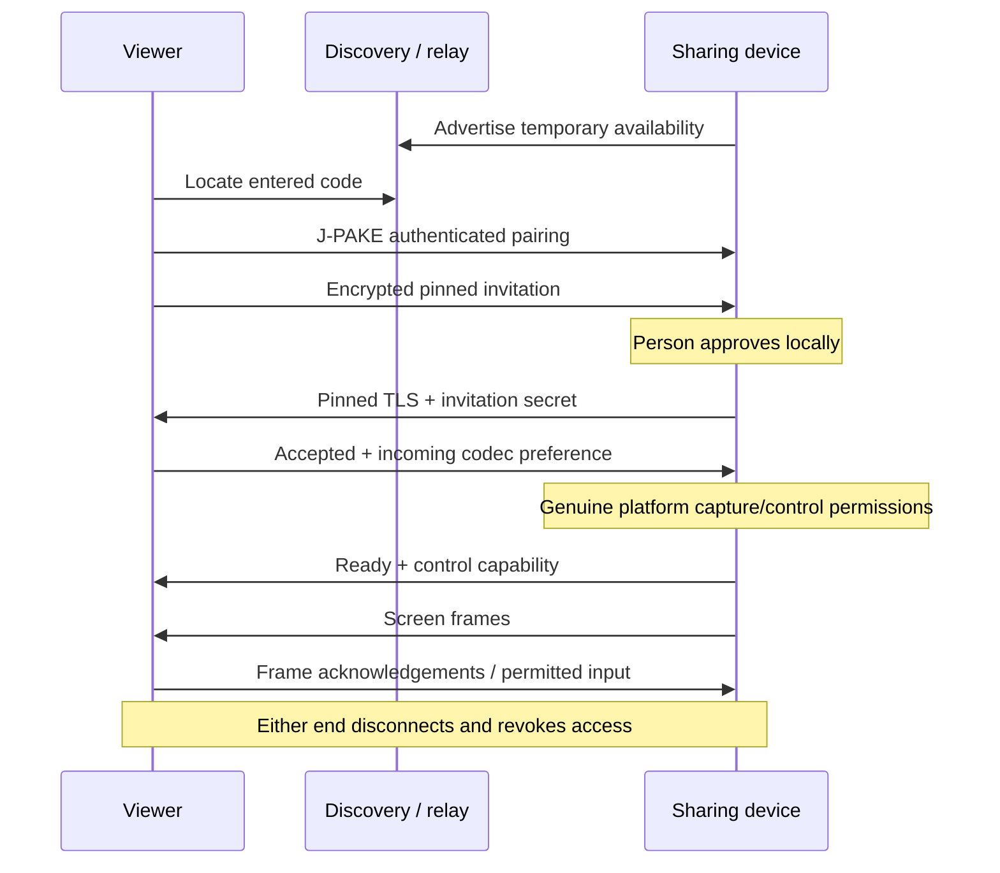

# Connection protocol, application version 0.7.0

This is an implementation guide, not a frozen interoperability standard or a
security audit. Update both apps together. Authoritative implementations are
[HelpSession.kt](../shared/src/main/kotlin/app/betterdesk/core/HelpSession.kt),
[Pairing.kt](../shared/src/main/kotlin/app/betterdesk/core/Pairing.kt),
[Invitation.kt](../shared/src/main/kotlin/app/betterdesk/core/Invitation.kt),
[RelayClient.kt](../shared/src/main/kotlin/app/betterdesk/core/RelayClient.kt),
[TlsIdentity.kt](../shared/src/main/kotlin/app/betterdesk/core/TlsIdentity.kt) and
[Wire.kt](../shared/src/main/kotlin/app/betterdesk/core/Wire.kt).

## Roles and state

The **viewer** enters a code. The **sharing device** displays that code and locally
approves a request. These are protocol descriptions, not roles the UI asks users
to choose. The viewer creates the ephemeral TLS identity and acts as the TLS
server, even over an outbound relay socket. The sharing device pins that identity
and sends screen frames. Input travels in the opposite direction.
These media roles can reverse after local switch approval; TLS client/server roles
stay fixed. Session wire protocol is now 3; the opaque relay API remains version 1.

`HelpSession` exposes HOME, INVITATION, PREPARING, WAITING, CONNECTING,
CONTROL_PERMISSION, SHARING, VIEWING, ENDED and ERROR. A successful pairing
acknowledgement means the invitation was delivered; it does not mean the person
approved capture. VIEWING begins after a valid frame is decoded. Stop clears
authorization first, advances the session generation, then closes resources so
queued work from the previous session cannot act in the next one.

## Discovery and route choice

Each device creates eight private random decimal digits. Online registration adds
a four-digit public routing prefix. The broker receives only the prefix, never the
private digits. Spaces and hyphens are removed from entered codes. Codes live for
five minutes; the local pairing host limits attempts to twelve.

LAN discovery uses UDP 39471, broadcast plus loopback and interface broadcast
addresses. A query is `BetterDesk/2 discover <nonce>`; a response is
`BetterDesk/2 device <nonce> <pairing-port>`. The nonce is a UUID; responses expose
an ephemeral endpoint but no code or invitation. Discovery is unauthenticated and
is not proof of identity. The app examines at most sixteen candidates.

Local discovery/pairing shares a 3.5-second attempt budget. After code authentication,
the requested device probes the viewer's screen port at the observed pairing peer
IP for up to 800 ms. A failed probe does not grant access or consume the invitation
as a successful local approval. It avoids selecting an unrelated VPN address.
If local setup fails before approval delivery, a twelve-digit code falls back to
Railway; an eight-digit code cannot. After delivery there is no second automatic
approval or live transport migration.

## Code pairing and invitation

J-PAKE uses Bouncy Castle's NIST-3072 group and SHA-256, including both peers'
round-three confirmation. Each round is UTF-8 JSON `{id, values}` prefixed by a
big-endian 32-bit byte length (1..8192). Round value counts are 6, 3 and 1; values
are bounded hexadecimal integers. Participant IDs identify connector/device plus
a fresh UUID. The code never appears in a transmitted plaintext field.

HKDF-SHA256 derives a 32-byte envelope key from the J-PAKE material and
`BetterDesk/2 pairing|<connector-id>|<device-id>`. Each direction sends one
AES-256-GCM envelope with a random 12-byte nonce and 128-bit tag. Its additional
authenticated data includes that context and a direction byte. The framed
payload is nonce followed by ciphertext/tag. One envelope carries the invitation;
the reverse envelope acknowledges delivery with `accepted`.

Invitation serialization uses an internal `betterdesk://help?...` URI with strict
fields, a maximum 2048 characters, no duplicates and no userinfo/fragment. Version
1 contains numeric private/loopback IPv4 hosts and a port; version 2 contains a
single-use relay ticket instead. Both carry an exact certificate SHA-256 pin,
random 256-bit secret, bounded display name and expiry. Generated invitations
expire in five minutes; parsing rejects expired or more-than-ten-minute future
values. A name is an unverified label, not the identity of a person.

Legacy local invitation handling remains for tests/compatibility, but links are
not the normal UI flow. External relay invitations are rejected: the relay variant
must arrive through authenticated code pairing. Never paste full invitations into
logs or issues.

## Relay API and byte forwarding

The production API is fixed to `https://api.betterdesk.dev`, with normal system
HTTPS trust, redirects disabled and JSON bodies limited to 16 KiB. The client
accepts protocol 1, `ready=true`, twelve code digits, a valid TCP port and a host
matching `[a-z0-9-]+.proxy.rlwy.net`. An internal test-only constructor accepts
HTTP loopback. There is no shipped arbitrary-server override.

| Request | Purpose / principal fields |
| --- | --- |
| `GET /v1/config` | `protocol`, `host`, `port`, `ready`, `codeDigits` |
| `POST /v1/devices` with `{}` | Register `id`, private bearer `token`, `expires` |
| `GET /v1/devices/{id}/next` with bearer | Long poll; `idle` or pairing `ticket`/expiry |
| `POST /v1/requests` with `{id}` | Allocate `pairTicket`, `viewerTicket`, `deviceTicket`, expiry |
| `DELETE /v1/devices/{id}` with bearer | Revoke availability |
| `DELETE /v1/requests` with `{ticket}` | Cancel the pending request/stream capability |
| `POST /v1/requests/status` with `{ticket}` | Check pending capability; 410 means inactive |

Tickets are 43-character URL-safe base64 capabilities. On a TCP connection the
client sends ticket plus LF and waits for byte `0x01`, then exchanges pairing or
TLS bytes. Two channels are allocated: pairing and the later stream. Both devices
connect outward. The relay does not terminate the session TLS or decode screens.
It can observe IPs, timing, routing metadata and traffic volume. Routing tickets
precede TLS and can be disrupted on a hostile network; possession does not defeat
J-PAKE, certificate pinning or local approval. See [SECURITY.md](../SECURITY.md).

The current single-region, single-replica broker keeps device/room state in memory.
Restart ends sessions. Service policy caps a stream at two hours or 2 GiB; current
deployment limits are owned by the infrastructure repository, not negotiated by
Wire. No TURN/UDP, port-443 tunnel, Internet peer-to-peer negotiation or resume is
implemented. PostgreSQL serves the separate website waitlist, not screen storage.

## Session packets inside pinned TLS

All integer headers use Java DataInput/DataOutput big-endian encoding. `length`
counts payload bytes only, excluding the header. A boolean is one byte.

| Type byte | Fields after type | Payload |
| --- | --- | --- |
| 1 | `length:int32` | UTF-8 Message JSON, 1..16,384 bytes |
| 2 | `length:int32, id:int64, width:int32, height:int32, epoch:int64` | JPEG, 1..2,000,000 bytes |
| 3 | Same as type 2 | Legacy independent AVC frame |
| 4 | Same as type 2, then `keyFrame:boolean` | Predictive AVC, including headers on keyframes |
| 5 | `length:int32, id:int64, epoch:int64` | Exactly 3,840 bytes: 20 ms, 48 kHz stereo signed PCM16 little-endian |

Frame IDs must be positive and strictly increase at the viewer. Each dimension is
1..4096 and the receive-side product cannot exceed 4,194,304 pixels. Decoders also
validate dimensions/content. Unknown packet types fail. Message decoding rejects
unknown JSON fields; known optional properties use defaults. This requires care
when changing the schema: there is no general backwards-compatibility negotiation.

The sharing side sends `hello` with the invitation secret and `protocol=3` after
TLS pin validation. The viewer replies `accepted` with `protocol=3`, its codec
preference and audio receive capability. Missing/wrong versions fail before media.
After actual capture permission/setup, the source sends `ready` with control/audio
availability and the current epoch. Every frame, audio packet, input, acknowledgement
and heartbeat carries that epoch. Audio IDs are positive and monotonically increasing
per direction; epochs start at zero and advance once per completed switch.
Normal messages are `ping`, `frameAck`, `capability` (control revoked) and `input`.
Closing transport ends the session; there is no persistent-access token.

Protocol 3 adds `exchangeClipboard` (session toggle), `exchangeText` (bounded text
and revision in `action`), `exchangeOffer` (bounded JSON FileOffer),
`exchangeRequest` (JSON TransferLink), `exchangeCancel`, `exchangeFailure`,
`exchangeBarrier` and `exchangeBarrierAck`. Cancel/failure use an offered ID in
`text`; barrier uses a request token in `text`, expected clipboard revision in
`secret`, and acknowledgement success in `control`. These are scoped to the
connection generation and survive a screen-direction epoch change. Control writes
use a bounded FIFO; a paste waits for the matching clipboard readiness acknowledgement.

The manifest contains only an ID, relative paths, lengths, directory flags and
kind (`files`, `clipboard`, `image`). The link carries a batch ID, new TLS pin,
secret, expiry, and either a same-peer LAN port or Railway ticket. Bulk transfer
never uses a screen packet type: its separate TLS connection uses file protocol 1.
After ID/secret authentication the receiver sends each file index and bounded resume
offset. Sender chunks are length-prefixed, at most 65,536 bytes. Every eight chunks
the receiver acknowledges the current offset and screen-pressure flag. A zero-length
chunk ends a file and is followed by its 32-byte SHA-256 digest. Receiver verifies
and acknowledges each file, then the batch. No byte can address an unoffered path.
See [files and clipboard](FILES_AND_CLIPBOARD.md) for limits and native interoperation.

`switchRequest` contains a random 43-character token in `text` and the current
epoch. A matching `switchAccepted` requires the remote person's approval;
`switchCancel` declines/cancels. Pending requests expire after 30 seconds and
disable remote input. Acceptance stops old capture/playback and drains media
writers. Each side sends `switchStopped` with the token, next epoch and its own
receive codec/audio capability. Both markers must arrive before roles flip and
new capture starts. Old-epoch media/input is discarded; fresh `ready` gates media.
Failure/denied new capture ends the session. See
[AUDIO_AND_SWITCHING.md](AUDIO_AND_SWITCHING.md) for lifecycle and race limitations.

The viewer acknowledges a frame after decoding/publishing it, **not** after physical
display scanout. Heartbeats run every 750 ms. A healthy unchanged capture can keep
the last frame usable; a capture-worker stall expires input. Capture queues hold
four frames; acknowledgement windows hold four locally or twelve over the relay.
Dropped predictive frames trigger bounded keyframe recovery rather than unbounded
buffering. See [PERFORMANCE.md](PERFORMANCE.md).

Input is an allowlist: `tap`, `right`, `swipe`, `scrollUp`, `scrollDown`, `text`,
`back`, `home`, `enter`, `backspace`, `copy`, `paste`, `selectAll`. Coordinates must be finite and within 0..1;
text is limited to 512 Kotlin string units. Input references a recent frame,
requires fresh capture within two seconds and current control authorization, and
is rate-limited at the source. Both platform adapters add their own restrictions.
An OS action already dispatched can finish after disconnect; disconnect is not
an undo operation.
