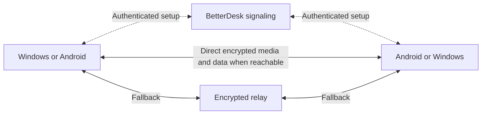

# Direct Internet connections: proposed design

Status: **implementation started; direct sessions are not enabled**. Prepared
10 October 2026 and continued at the owner's request. Start with the
[handoff and work checklist](DIRECT_CONNECTIONS_HANDOFF.md). This document describes
the intended feature, not the capabilities of the current release.

## Outcome

Connect Windows and Android directly even when they use different Internet
connections, reducing avoidable relay delay and traffic. Preserve the current
experience: enter a code, the other device approves or uses its locally saved
verified-device grant, then connect. Route selection
is automatic and symmetric across both apps.

Preference: reachable local network, then direct Internet, then an encrypted relay
when direct connectivity is unavailable. Prefer a healthy direct route; do not
force it when measurements show it is unusable. Do not promise universal direct
connectivity, lower latency on every path, or guaranteed 60 FPS.

The backend still handles discovery/signaling and relay fallback. Direct payloads
must eventually include video, device playback audio, input, clipboard and files;
moving only video does not complete this feature.

## Product contract

- Keep the same code/Connect/Allow flow, shared black UI, languages and native
  permissions. One connection attempt produces at most one approval request.
- Do not add a VPN installation, account, network selector, port-forwarding wizard
  or generic Internet-permission question. The app already uses the Internet.
- Keep OS capture/control prompts genuine. Finding a network route grants no
  capture, audio, clipboard, file or input authorization.
- A quiet connection detail may show **Local connection / Ligação local**,
  **Direct connection / Ligação direta**, or **Using relay / A usar retransmissão**.
  Show the actual selected route, never just a configured preference. Intermediate
  mixed routes belong in diagnostics, not a misleading all-direct label.
- Switching transport within the same approved session must not ask for approval
  again. Switching which screen is shared still requires the existing approval.
- Disconnect and the Android sharing notification must revoke every path and
  pending attempt. No revival after Stop, expiry or permission revocation.
- Hotspots/Wi-Fi Direct connect nearby devices and are outside this feature.
  Internet sharing, exit nodes, autostart and routing other apps are also outside
  scope. Direct routing inherits the owner-approved 0.9.0 saved-device grants; it
  must not introduce additional persistent authorization mechanisms.

## Verified baseline

The production authorization baseline has advanced to **0.9.0 source**: signed
invitation v3/v4 binds a persistent requesting key to the ephemeral TLS pin,
secret, route, name and expiry. Only code-paired delivery may match a recipient-local
Always allow grant; otherwise approval and the local-before-capture choice remain
required. Grants/names never go to the peer. New DTLS/signaling contexts must retain
this identity/authorization binding, OS consent, revocation and session-only control
approval. See the [updated handoff](DIRECT_CONNECTIONS_HANDOFF.md#production-authorization-update-16-october-2026).
At the pre-merge snapshot on 16 October, 0.8.1 was published and 0.9.0 was under
review; consult the current release for delivery status. The facts below describe the **historical start** of this design, not the complete current app.

At app commit `87f57b7b220eac3604a3b25dd35b1c16652d2491` (0.7.1):

- LAN discovery/authenticated pairing has a 3.5-second budget and an 800 ms
  reachability probe. A failed local attempt can use Railway before approval.
- Internet sessions authenticate the code with J-PAKE through opaque Railway TCP
  rooms, then use pinned TLS for the session. There is no Internet ICE/STUN/TURN.
- Session protocol is **4**, relay HTTP API is **1**, file protocol is **1**.
  Strict Message decoding means adding fields to an old handshake is incompatible.
- `HelpSession` owns concrete sockets/Wire, approval, capture, heartbeat, input,
  switching and teardown. A socket failure currently ends the whole session.
- Android produces AVC through MediaCodec; Windows currently produces JPEG.
  Audio is PCM. Audio/video share TCP, so improving route length alone does not
  remove reliable-stream head-of-line delay or encoding bottlenecks.
- Files use separate pinned TLS connections. Their current route is derived from
  the session's LAN/relay state, so file routing needs explicit adaptation.
- 0.7.1 compiled/packaged locally. Keyboard and transfer runtime checks remain
  unverified because the owner paused tests and audio workloads.

The infrastructure checkout inspected at
`6a2f50c00a531900976687ea049a5632f0fbff6b` is a single-replica Node broker with
in-memory leases/rooms, HTTP signaling and a public TCP proxy. Its PostgreSQL
database serves the website waitlist. This was source inspection, not a new live
deployment/health verification. Recheck both repository heads before implementing.

## Preferred architecture, subject to the first feasibility milestone

Use a maintained native WebRTC engine behind Kotlin platform adapters for both
apps. ICE handles candidate discovery/checks, STUN discovers reachable addresses,
and TURN relays when required. Use the engine's media transport rather than placing
all screen/audio frames into one reliable data channel. WebRTC supports media and
binary data between peers, with signaling supplied by the application.
[WebRTC connection model](https://webrtc.org/getting-started/peer-connections)

The [native feasibility proof](../../experimental/README.md) provisionally selects
webrtc-java 0.19.0 for desktop and webrtc-sdk Android 150.7871.01. Both adapters are
behind an explicit build opt-in and have no connection to production sessions.
This is not a completed integration or a shipped direct-connection feature. Assess
Windows JVM/JNI packaging, Android ABI support, hardware capture/codec integration,
memory/CPU/battery footprint, maintenance, notices and supply-chain verification.
A smaller ICE/data-channel implementation is a valid alternative only if the
proposal also accounts for media congestion control, codecs and loss recovery.
Keep rationale and measured evidence here if a later agent improves the choice.

Native WebRTC's Android source workflow requires Linux. Establish a reproducible
local solution using inspected dependency artifacts. The owner authorized bounded
local Linux compilation/synthetic testing on this VM on 10 October 2026 because
no reachable Windows host is available. Windows capture/packaging coverage remains
pending; no cloud native build is authorized. Do not download/build the full WebRTC tree
as an incidental planning step. [Upstream Android build instructions](https://webrtc.googlesource.com/src/+/main/docs/native-code/android/)

### Separate session ownership from transport ownership

Introduce interfaces incrementally; names below are proposed, not existing types:

| Boundary | Responsibility |
| --- | --- |
| `SessionCoordinator` (initially HelpSession) | One approved session, participant identity, expiry, permissions, direction epoch and Stop authority |
| `SessionTransport` | Reliable ordered control/input, media sinks/sources, readiness, route statistics and deterministic close |
| `LegacyTlsTransport` | Adapt existing Wire/TLS without changing its behavior; migration fallback |
| `WebRtcTransport` | Native peer connection, authenticated DTLS identity, media tracks and bounded data channels |
| `RouteCoordinator` | Bounded attempts, selection/commit, transport generation, route failure and cancellation |
| Transfer interface | Existing manifest, approval, hashing and native save semantics over either transfer transport |

Expose real engine statistics and events through shared state. Keep OS capture,
editor control, MediaProjection/foreground service ownership and native handles
behind platform interfaces. Do not let a transport adapter own or fabricate consent.

### Bootstrap and authentication

For the first isolated proof, exchange WebRTC descriptors/candidates inside the
existing code-authenticated, pinned TLS connection. That provides an authenticated
place to bind peer DTLS certificate fingerprints, session identity and capability
negotiation without inventing an unauthenticated signaling path.

This proof still needs the Railway TCP bootstrap and **does not solve networks
that block that port**. Full release scope includes a separately reviewed HTTPS
signaling path in the infrastructure repository, usable without first opening the
legacy screen TCP room. Choose WebSocket or bounded long polling based on the
existing broker/runtime constraints; no choice is implemented in this PR.

The HTTPS version needs code-authenticated, end-to-end protected signaling, not
merely HTTPS server trust or possession of a routing ticket. Write its schema,
transcript binding, directional keys, nonce/sequence rules and replay bounds before
implementation. Reuse established cryptographic primitives and obtain protocol
review. `CodeExchange.sendSecret/receiveSecret` deliberately allow **one envelope
per direction**; do not reuse them as a trickle-candidate stream or reuse nonces.

For either bootstrap:

- Bind negotiated capabilities, peer DTLS fingerprints, both participant IDs,
  session ID, expiry and transport generation to the authenticated exchange.
  A valid self-signed DTLS certificate alone is not peer authentication.
  [WebRTC security architecture](https://www.rfc-editor.org/rfc/rfc8827.html)
- Authenticate updates before accepting candidates, restarts, route changes or
  fallback commands. ICE credentials are connection parameters, not user consent.
- Keep code expiry, attempt limits, cancellation and single delivery. Never turn
  broker-created tickets into proof of the private code.
- Negotiate a versioned transport capability before new session fields. Decide
  whether to support older apps explicitly or fail with an update message. Never
  silently retry plaintext, unknown hosts, or weaker authentication on failure.
- Current rules specify pinned TLS. The WebRTC implementation must document and
  update the relevant rules/security guide together to describe authenticated
  DTLS/SRTP protection; it cannot quietly remove peer authentication.

### Media, control and files

| Payload | Intended path and requirements |
| --- | --- |
| Screen video | Native WebRTC video track/SRTP with congestion feedback, bounded frame age, hardware codec where viable and keyframe recovery. Preserve text readability, aspect ratio and distinct-frame metrics. |
| Device sound | Native audio track from existing playback capture, never the default microphone source. Preserve mute, permission behavior and bounded buffering; document resampling/codec choices. |
| Session/input | Reliable ordered channel with bounded queues, existing allowlists/freshness checks, atomic key chords, clipboard barriers and direction epochs. Reliable delivery does not authorize stale execution. |
| Clipboard metadata | Ordered authenticated control channel, preserving both-device toggles and Android foreground rules. |
| Files | Separate logical channel/transport with chunking, backpressure, cancellation, hashes and existing size/path limits. Respect negotiated data-channel message limits; existing 64 KiB chunks are not automatically safe as one message. |

Separate WebRTC channels can still share congestion and a native association.
Prove that file transfer cannot starve input/audio/video; implement an explicit
bulk budget instead of assuming channel separation guarantees priority.

Windows encoding and Android decoding both need attention: introducing AVC from
Windows also requires an Android decoder/video-render path. Do not double-encode
Android's current MediaCodec output accidentally, or let an engine start its own
second MediaProjection/camera/microphone capture. Decide whether existing surfaces
feed native tracks or whether capture ownership changes, then document lifetimes.

### Route selection and lifecycle

1. Preserve the current bounded LAN preference and offline local-code behavior.
2. Authenticate the signed requesting device and retain the recipient's local
   approval or verified saved grant. Show the local remember/name choice only for
   a new signed code request; no private content travels while required local or
   genuine OS capture permission is pending.
3. Start a usable approved transport promptly; attempt direct ICE without delaying
   an already usable relay. In the proof this means bootstrap relay first, then
   a background direct upgrade. Do not launch duplicate capture pipelines.
4. Verify the new path's peer identity and readiness, then exchange an explicit
   prepare/ready/commit acknowledgement for a new **transport generation**.
   Stop old writers before activating new ones. Keep this separate from the
   existing screen-direction epoch; reject stale callbacks and payloads from either.
5. Preserve keyboard, paste and transfer ordering. Do not replay an input batch
   that might already have executed. Invalidate stale pending input across the
   cutover and require a fresh displayed frame before re-enabling control.
6. If the direct path fails, use a validated TURN path or legacy fallback within
   the same still-approved session when feasible. Recheck freshness and identity.
   Otherwise end clearly; no silent new session after Stop, expiry or lost consent.
7. Close unused attempts, sockets, allocations, tracks, encoders/decoders and native
   references on every failure, switch and cancellation path.

Suggested initial limits for later measurement: give a direct upgrade at most
five seconds before keeping the working route; allow one concurrent upgrade per
session; at most one ICE restart per network-change event with a cooldown. A
30-second maximum pending setup is a starting proposal. Preserve existing tighter
code/approval expiry rules. These values are **proposals, not measured results**.

Once direct media/control are active, loss of optional signaling should not alone
destroy a healthy authenticated direct path. This requires changing HelpSession's
current socket-failure coupling, explicit session deadlines and peer liveness.
Stop must still reach the peer over the active channel; failed liveness must revoke
access. Broker restart survival, ICE restart and returning after a terminated
session are different cases; the last always needs a fresh attended connection.

Keep file-channel routing honest during migration. Until files migrate, show a
mixed route in local diagnostics and do not claim all payload bypasses Railway.
Define whether active transfers drain or cancel at route cutover; preserving
verified same-session offsets is acceptable, silent byte duplication is not.

## Hosting and operational dependencies

Keep code lookup/signaling on Railway and the website on Vercel. The current
Railway endpoint is a TCP proxy, not a TURN server. Its public documentation
describes HTTP/TCP ingress; private-network UDP support does not establish public
UDP reachability. Public UDP allocation/relay support must be verified before
selecting Railway for STUN/TURN. [Railway TCP proxy](https://docs.railway.com/networking/tcp-proxy)

The owner delegated the hosting choice on 10 October 2026. Select
[Cloudflare Realtime TURN](https://developers.cloudflare.com/realtime/turn/)
for the managed fallback rather than operating a new TURN host. Its documented
service supports UDP, TCP and TLS (including TLS on 443). The documented free
allowance is 1,000 GB, with additional egress at $0.05/GB; verify account terms and
billing controls before provisioning. Account-scoped key access, credential
issuance, quotas and external reachability remain **not provisioned or verified**.
The owner has no Cloudflare account; creating one is a provisioning prerequisite.
The dashboard login was checked, but no account, key or billable resource was created.
The Railway relay remains the working production fallback. Do not reuse unrelated
project secrets or repurpose fleet machines. See [credential generation](https://developers.cloudflare.com/realtime/turn/generate-credentials/)
and [pricing FAQ](https://developers.cloudflare.com/realtime/turn/faq/).

The companion [infrastructure draft](https://github.com/DJProspero1/BetterDesk-Infrastructure/pull/1)
prepares an internal bounded Cloudflare credential/revocation client. Synthetic
validation passed; the broker does not import it and exposes no issuance endpoint.
Provider credentials do not encode BetterDesk consent or session identity. Reviewed
session-bound authorization, issuance/spending budgets and signaling must precede
enabling it; this preparation does not mean TURN is provisioned or usable.

Requirements before deployment: UDP and appropriate TCP/TLS fallback listeners,
real external reachability tests, short-lived scoped credentials, quotas and rate
limits, allocation expiry, abuse controls, restricted relay destinations, TLS
certificates, operational health and a documented rollback. Never ship a TURN
administrator/shared signing secret in either client. Credential issuance cannot
be an unauthenticated endpoint that makes us an open relay. Define how it is bound
to an authorized session without giving the broker the private pairing code.

Prefer an EU region initially, but measure path quality before making a placement
claim. Direct traffic still uses each person's Internet connection/data allowance.
Peers may learn each other's public IPs; STUN/TURN/signaling operators see network
metadata. Avoid storing candidates, IPs, credentials or raw SDP in routine logs.
Do not claim encryption hides routing metadata or lets us retain relay traffic
caps automatically when traffic bypasses the relay.

## Risks and decisions that must stay visible

| Risk / open decision | Required handling |
| --- | --- |
| Hard NAT, CGNAT combinations, blocked UDP | Measure actual direct success; keep TURN/legacy fallback. CGNAT does not imply every connection must fail. |
| Native dependency size, local Linux build and maintenance | First milestone establishes a viable integration on both targets before committing to an SDK. |
| Signaling substitution or fingerprint downgrade | End-to-end authenticated transcript/fingerprints; reject mismatch/replay before content or input. |
| Multiple paths racing approval/Stop | One session owner, explicit transport generation and tested teardown; no duplicate permission prompts. |
| TCP-only corporate networks | Prove HTTPS signaling and TURN TCP/TLS reachability; port 443 alone does not guarantee proxy compatibility. |
| Wi-Fi/mobile transition and Android background limits | Bounded ICE restart, foreground lifecycle and physical OEM coverage; no promise of process survival. |
| File saturation or media queues | Measure frame age/input latency with transfers; enforce budgets and bound queues. |
| Lower latency mistaken for higher FPS | Measure capture, encode/decode, display, RTT and loss separately; retain 60 FPS as a goal. |
| Broker-enforced two-hour/byte limits on direct paths | Decide and enforce client session lifetime explicitly; preserve the two-hour ceiling initially. Direct bytes cannot be counted reliably by the broker. |
| Partial rollout / old apps | Capability/version policy and rollback before enabling by default. Legacy support must not permit security downgrade. |

Connection attempts should follow ICE consent/reachability checks from a proven
engine, not home-grown arbitrary IP probing. Authenticated peers can still be
malicious: bound candidate counts, sizes, gathering time and native allocations;
reject loopback, unspecified, multicast, metadata-service and invalid destinations
as appropriate to the route. Define LAN/IPv6/mDNS policy explicitly rather than
copying today's private-IPv4-only invitation parser into public ICE handling.

## Completion bar

The work checklist owns delivery status. The feature is complete only when both
apps demonstrate direct Internet sessions on separate networks, proven relay
fallback, preserved approval/Stop/security behavior, and real media/input/files
interoperation. A local pair, STUN address, connected data channel, compilation or
configured 60 FPS value alone is insufficient evidence.

Keep route statistics local and aggregate: selected candidate type/protocol,
route-change count/reason, setup duration, RTT, loss, bitrate, frame age, distinct
drawn FPS and gaps. No private addresses, content or session credentials in saved
reports. Controlled peer-only packet capture, if explicitly authorized later,
can substantiate that payload takes the direct route; avoid unrelated machine traffic.
